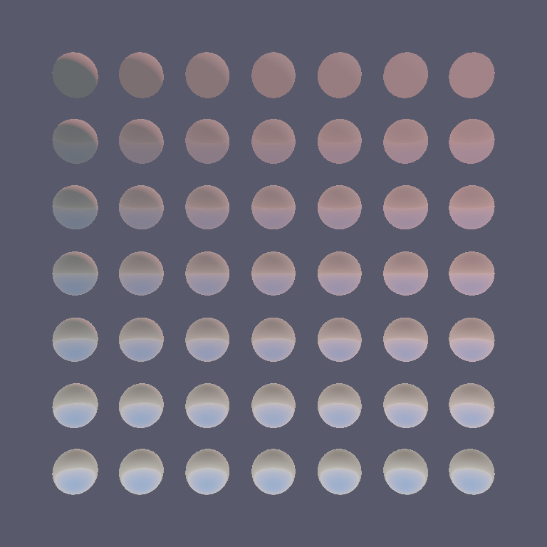
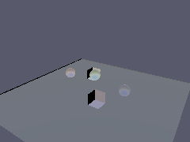
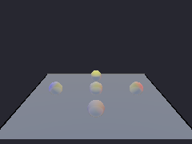
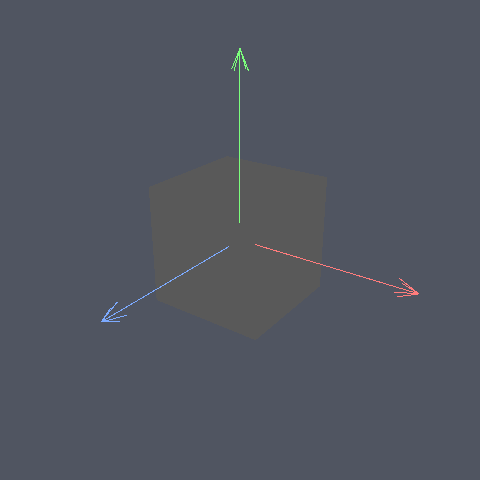
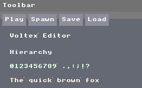

# Voltex Engine

> Rust로 만든 3D 게임 엔진. 외부 런타임 의존은 winit, wgpu, bytemuck 셋이고, 수학, 이미지·메시 파서, 물리, 오디오, 에디터 UI, Lua 바인딩, 빌드 도구까지 직접 구현했다.

## 저장소 구성

| 폴더 | 내용 |
|---|---|
| [`engine/`](engine) | 엔진 crate. 게임 코드는 facade crate `voltex` 하나로 엔진 전체를 쓴다 |
| [`tools/`](tools) | 엔진을 쓰는 도구. `voltex_cli`(게임 빌드 명령 `voltex`), `voltex_capture`(렌더 결과 PNG 캡처) |
| [`games/`](games) | 엔진으로 만든 게임 3편 |
| [`examples/`](examples) | 기능별 짧은 예제 |
| [`docs/`](docs) | 사용 문서. `docs/dev/`와 `docs/superpowers/`는 개발 기록 |

## 스크린샷

엔진 렌더러로 그린 화면이다. 다시 찍는 방법은 [docs/visual](docs/visual/README.md).

| PBR 재질 | 그림자 | 다중 광원 |
|---|---|---|
|  |  |  |

| 기즈모 | 에디터 UI |
|---|---|
|  |  |

## 실행해 보기

```bash
git clone https://git.tolelom.xyz/tolelom/game_engine
cd game_engine
cargo run -p triangle
```

창에 색 삼각형이 뜨면 된다. `ESC`로 닫는다. 다른 example과 추천 순서는 [examples/README.md](examples/README.md)에 있다.

### 새 게임 만들기

`voltex` CLI가 프로젝트를 만들고, 씬·스크립트·에셋을 실행 파일 하나에 묶는다.

```bash
cargo install --path tools/voltex_cli
export VOLTEX_REPO=$(pwd)        # 엔진 경로. 없으면 --engine-path로 지정

cd ~/projects
voltex new my_game && cd my_game
voltex build                     # dist/에 실행 파일 생성
voltex run                       # 빌드 후 실행
```

PowerShell에서는 `$env:VOLTEX_REPO='C:/path/to/game_engine'`. 처음부터 따라가는 안내는 [docs/tutorial.md](docs/tutorial.md).

Rust 코드에서는 `voltex` crate 하나로 엔진 전체를 쓴다.

```rust
use voltex::prelude::*;

fn main() -> voltex::runtime::RuntimeResult<()> {
    let cfg = RuntimeConfig::new()
        .with_window_title("hello voltex")
        .with_initial_scene("scene.vscn");
    RuntimeApp::new(cfg)?.run()
}
```

## 엔진으로 만든 게임

엔진을 실제로 써 보려고 만든 게임이다. 쓰면서 막힌 점은 엔진에 되돌려 고쳤다.

| 게임 | 내용 | 실행 |
|---|---|---|
| [survivor](games/survivor/README.md) | 웨이브 서바이벌. 게임 로직을 Lua와 씬 파일로 작성 | `cargo run -p survivor` |
| [depths](games/depths/README.md) | 탑다운 트윈스틱 던전 슈터. 게임 로직을 Rust로 작성 | `cargo run -p depths` |
| leap | 2D 사이드뷰 플랫포머. 스프라이트와 타일맵으로 제작 | `cargo run -p leap` |

## 기능

| 영역 | 내용 |
|---|---|
| ECS | 엔티티·컴포넌트 저장, 부모·자식 계층, 씬 저장·불러오기 |
| 렌더링 | PBR 재질, 실시간 그림자, 디퍼드 렌더링, 레이트레이싱 그림자·반사, 후처리 |
| 물리 | 다양한 모양의 충돌 판정, 강체 시뮬레이션, 레이캐스트 |
| 오디오 | OS별 출력 백엔드, 3D 위치 사운드, 믹서 |
| AI | 내비게이션 메시 자동 생성, 경로 탐색, 이동 조종 |
| 네트워크 | UDP 위의 신뢰 전송, 상태 동기화와 보간 |
| 스크립트 | Lua 5.4, 엔티티별 스크립트, 핫 리로드 |
| 에디터 | 도킹 UI, 3D 뷰포트, 인스펙터, 기즈모, 실행·정지, 실행 취소 |
| 파일 | 이미지·모델·오디오 디코더(PNG, JPG, glTF, OBJ, WAV, OGG) 직접 구현 |
| 빌드 | `voltex` CLI가 게임과 에셋을 실행 파일 하나로 묶음 |

## crate 구성

`engine/`

```
voltex              facade. 하위 crate 재노출과 prelude
├── voltex_math       벡터·행렬·쿼터니언·AABB·Ray
├── voltex_platform   창·입력·타이머
├── voltex_asset      핸들, 에셋 저장소, 파일 감시, .vpkg
├── voltex_image      이미지·메시 디코더, PNG 인코더
├── voltex_ecs        World·Entity·Component·Scheduler·씬
├── voltex_audio      디코더, 믹서, OS별 백엔드
├── voltex_ai         NavMesh, 경로 탐색, steering
├── voltex_net        UDP, 신뢰 채널, 스냅샷, 보간
├── voltex_script     Lua 5.4와 엔진 API 바인딩
├── voltex_renderer   wgpu 렌더러
├── voltex_renderer_ecs  ECS 데이터로 렌더링하는 연결층
├── voltex_physics    충돌·강체·레이캐스트
├── voltex_editor     즉시 모드 UI와 에디터
└── voltex_runtime    창·렌더·물리·스크립트를 묶은 앱 진입점
```

`tools/`

```
voltex_cli          voltex 명령(new·build·run)
voltex_capture      오프스크린 렌더 캡처. 시각 회귀 확인용
```

crate별 책임과 주의점은 각 crate의 `CODEMAP.md`에 있다.

## 문서

사용 문서

- [docs/tutorial.md](docs/tutorial.md): 빈 프로젝트에서 미니 게임까지
- [docs/voltex-toml-reference.md](docs/voltex-toml-reference.md): `voltex.toml` 필드
- [docs/build-matrix.md](docs/build-matrix.md): OS별 빌드
- [docs/release.md](docs/release.md): 릴리스 절차
- API 문서: `cargo doc --workspace --no-deps --open`

개발 기록

- [CHANGELOG.md](CHANGELOG.md): 버전별 변경
- [docs/superpowers/](docs/superpowers/): 설계(specs)와 구현 계획(plans)
- [docs/dev/](docs/dev/): 작업 현황, 미룬 항목

## 기여

코드를 고치려면 [CONTRIBUTING.md](CONTRIBUTING.md)를 먼저 읽는다.

## 라이선스

[MIT](LICENSE-MIT) 또는 [Apache-2.0](LICENSE-APACHE) 중 하나를 골라 따른다.

의존 crate의 라이선스 고지는 [THIRD-PARTY-LICENSES.md](THIRD-PARTY-LICENSES.md).
