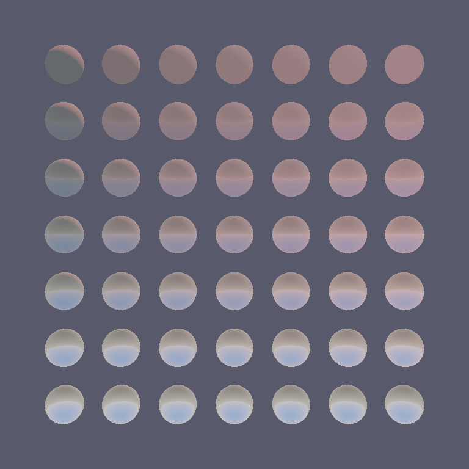

# Voltex Engine

> Rust로 만든 3D 게임 엔진

Rust · wgpu · winit · Lua 5.4



외부 crate는 wgpu·winit(GPU와 창)과 작은 보조 crate(bytemuck, thiserror, log, pollster)만 쓰고, 수학, 이미지·메시 파서, 물리, 오디오, 에디터 UI, Lua 바인딩, 빌드 도구는 직접 구현했습니다. Lua는 C 소스를 넣어 직접 빌드합니다.

## 기능

- 엔티티·컴포넌트 저장, 부모·자식 계층, 씬 저장·불러오기
- PBR 재질, 실시간 그림자, 디퍼드 렌더링, 레이트레이싱 그림자·반사, 후처리
- 여러 모양의 충돌 판정, 강체 시뮬레이션, 레이캐스트
- OS별 오디오 출력, 3D 위치 사운드, 믹서
- 내비게이션 메시 자동 생성, 경로 탐색, 이동 조종
- UDP 위의 신뢰 전송, 상태 동기화와 보간
- Lua 5.4 엔티티별 스크립트와 핫 리로드
- 도킹 UI, 3D 뷰포트, 인스펙터, 기즈모, 실행·정지, 실행 취소를 갖춘 에디터
- PNG, JPG, glTF, OBJ, WAV, OGG 디코더
- 게임과 에셋을 실행 파일 하나로 묶는 `voltex` CLI

## 시작하기

Rust stable이 필요합니다. Linux는 ALSA 헤더(`sudo apt-get install -y libasound2-dev`)도 필요합니다.

```bash
git clone https://github.com/tolelom/voltex-engine.git
cd voltex-engine
cargo run -p triangle
```

창에 색 삼각형이 뜨면 됩니다. `ESC`로 닫습니다. 다른 예제와 추천 순서는 `examples/README.md`에 있습니다.

엔진으로 만든 게임도 같은 방식으로 실행합니다.

| 게임 | 내용 | 실행 |
|---|---|---|
| [survivor](games/survivor/README.md) | 웨이브 서바이벌. 게임 로직을 Lua와 씬 파일로 작성 | `cargo run -p survivor` |
| [depths](games/depths/README.md) | 탑다운 트윈스틱 던전 슈터. 게임 로직을 Rust로 작성 | `cargo run -p depths` |
| leap | 2D 사이드뷰 플랫포머. 스프라이트와 타일맵 | `cargo run -p leap` |

### 새 게임 만들기

`voltex` CLI가 프로젝트를 만들고, 씬·스크립트·에셋을 실행 파일 하나에 묶습니다.

```bash
cargo install --path tools/voltex_cli
export VOLTEX_REPO=$(pwd)        # 엔진 경로. 없으면 --engine-path로 지정

cd ~/projects
voltex new my_game && cd my_game
voltex build                     # dist/에 실행 파일 생성
voltex run                       # 빌드 후 실행
```

PowerShell에서는 `$env:VOLTEX_REPO='C:/path/to/voltex-engine'`로 지정합니다. 처음부터 따라가는 안내는 `docs/tutorial.md`에 있습니다.

Rust 코드에서는 `voltex` crate 하나로 엔진 전체를 씁니다.

```rust
use voltex::prelude::*;

fn main() -> voltex::runtime::RuntimeResult<()> {
    let cfg = RuntimeConfig::new()
        .with_window_title("hello voltex")
        .with_initial_scene("scene.vscn");
    RuntimeApp::new(cfg)?.run()
}
```

## 문서

| 문서 | 내용 |
|---|---|
| `ARCHITECTURE.md` | 저장소 폴더, crate 층, 한 프레임, 코드 읽는 순서 |
| `engine/*/CODEMAP.md` | crate별 책임, 공개 API, 고칠 때 주의점 |
| `docs/tutorial.md` | 빈 프로젝트에서 미니 게임까지 |
| `docs/voltex-toml-reference.md` | `voltex.toml` 필드 |
| `docs/build-matrix.md` | OS별 빌드 |
| `docs/release.md` | 릴리스 절차 |
| `docs/visual/README.md` | 스크린샷과 다시 찍는 방법 |
| `docs/dev/` | 남은 할 일, 미룬 항목과 알려진 한계, 감사 백로그 |
| `CHANGELOG.md` | 버전별 변경 |

API 문서는 `cargo doc --workspace --no-deps --open`으로 엽니다.

## 기여

검사 명령, git 훅, 코드 규칙은 `CONTRIBUTING.md`에 있습니다.

## 라이선스

[MIT](LICENSE-MIT) 또는 [Apache-2.0](LICENSE-APACHE) 중 하나를 골라 따릅니다. 의존 crate의 라이선스 고지는 `THIRD-PARTY-LICENSES.md`에 있습니다.
