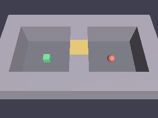

# Voltex Depths — 도그푸딩 게임 1편

> 탑다운 트윈스틱 던전 슈터. WASD 이동 + 마우스 조준/발사, 적 3종
> (추적자 / 사수 / 보스) + region 기반 문 진행. survivor(Lua 주도)와
> 반대로 게임 로직을 **100% Rust**로 작성해 엔진의 Rust API 워크플로를
> 도그푸딩한 결과물.

## 실행

```bash
cargo run -p depths            # 개발 빌드
cargo run -p depths --release  # 릴리스
```

`voltex build`로도 빌드된다. 이 게임의 `voltex.toml`은 Rust 게임용 `kind = "rust"` 빌드
모드를 쓴다.

## 조작

- **WASD** — 이동
- **마우스** — 조준, **좌클릭** — 발사
- **Space** — 게임 시작 (타이틀 화면)
- **R** — 재시작 (게임오버/클리어 화면)
- ESC / 창 닫기 — 종료

## 에셋 재생성

효과음/BGM(`assets/*.wav`)은 절차 생성. 변경 시:

```bash
cargo run -p depths --bin gen_sfx
```

## 테스트

```bash
cargo test -p depths                       # 단위 + 헤드리스 풀 플레이스루
cargo test -p depths --test visual -- --ignored  # GPU 시각 회귀 (GPU 필요)
```

시각 회귀는 던전 씬을 오프스크린 렌더해 플레이어(green)/적(red) 픽셀
존재를 단언하고 스크린샷을 갱신한다.

## 스크린샷



## 디렉토리 구조

| 파일/디렉토리 | 역할 |
|---|---|
| `src/level.rs` | ASCII 맵 파싱, region/NavMesh 빌드, 레벨 시딩, 축 분리 이동 |
| `src/enemy.rs` | 적 AI — region 활성화, 추적/사수/보스 패턴 |
| `src/combat.rs` | 조준 unprojection, 투사체, 접촉 데미지, 사망 처리 |
| `src/game_state.rs` | 문 개방, 시작/재시작, HUD |
| `src/components.rs` | 게임 컴포넌트/리소스/이벤트 |
| `src/bin/gen_sfx.rs` | 효과음/BGM 절차 생성기 |
| `tests/playthrough.rs` | 헤드리스 풀 플레이스루 (입력 시뮬레이션 → 클리어까지) |
| `tests/visual.rs` | GPU 픽셀 회귀 (`voltex_capture::render_world`) |

## 알려진 한계

- navmesh가 닫힌 문도 지나갈 수 있는 곳으로 본다. 적이 문 너머로 경로를 잡을 수 있어, 방에 들어가야 그 방의 적이 깨어나게 해서 보완한다.

