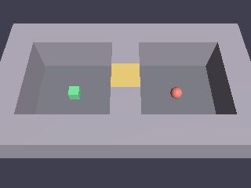

# Voltex Depths — 도그푸딩 게임 1편

> 탑다운 트윈스틱 던전 슈터. WASD 이동 + 마우스 조준/발사, 적 3종
> (추적자 / 사수 / 보스) + region 기반 문 진행. voltex_survivor(Lua 주도)와
> 반대로 게임 로직을 **100% Rust**로 작성해 엔진의 Rust API 워크플로를
> 도그푸딩한 결과물. 발견한 마찰은 `docs/dogfood-friction.md`에 기록.

## 실행

```bash
cargo run -p voltex_depths            # 개발 빌드
cargo run -p voltex_depths --release  # 릴리스
```

`voltex build`(CLI 패키징)도 지원한다 — v1.0.110의 `kind = "rust"` 빌드
모드를 이 게임의 `voltex.toml`이 사용 중이다 (friction #8 해소).

## 조작

- **WASD** — 이동
- **마우스** — 조준, **좌클릭** — 발사
- **Space** — 게임 시작 (타이틀 화면)
- **R** — 재시작 (게임오버/클리어 화면)
- ESC / 창 닫기 — 종료

## 에셋 재생성

효과음/BGM(`assets/*.wav`)은 절차 생성. 변경 시:

```bash
cargo run -p voltex_depths --bin gen_sfx
```

## 테스트

```bash
cargo test -p voltex_depths                       # 단위 + 헤드리스 풀 플레이스루
cargo test -p voltex_depths --test visual -- --ignored  # GPU 시각 회귀 (GPU 필요)
```

시각 회귀는 던전 씬을 오프스크린 렌더해 플레이어(green)/적(red) 픽셀
존재를 단언하고 스크린샷을 갱신한다.

## 스크린샷



## 디렉토리 구조

| 파일/디렉토리 | 역할 |
|---|---|
| `src/level.rs` | ASCII 맵 파싱, region/NavMesh 빌드, 레벨 시딩, 축 분리 이동 |
| `src/enemy.rs` | 적 AI — region 활성화, 추적/사수/보스 패턴 |
| `src/combat.rs` | 조준 unprojection, 투사체, 접촉 데미지, 사망 처리 |
| `src/game_state.rs` | 문 개방, 시작/재시작, HUD |
| `src/components.rs` | 게임 컴포넌트/리소스/이벤트 |
| `src/bin/gen_sfx.rs` | 효과음/BGM 절차 생성기 |
| `tests/playthrough.rs` | 헤드리스 풀 플레이스루 (입력 시뮬레이션 → 클리어까지) |
| `tests/visual.rs` | GPU 픽셀 회귀 (`voltex_capture::render_world`) |

## 알려진 한계

- ~~창 크기 1280x720 고정 조준 / DPI 100% 가정~~ — **해소** (friction #4):
  조준 NDC 변환이 `input.window_size()`(물리 픽셀, 리사이즈/DPI 반영)를 사용.
  조준점에 노란 십자 디버그 마커가 항상 표시됨 (도그푸딩 진단용 — 마커
  위치가 곧 게임이 인식한 클릭 위치).
- **에셋 절대경로** — `CARGO_MANIFEST_DIR` 기준이라 빌드 머신 밖 배포 exe는
  소리가 안 남 (friction #6, #8).
- **navmesh가 닫힌 문을 워크블 취급** — 적이 문 너머로 경로를 잡을 수 있어
  region 활성화(방에 들어가야 적이 깨어남)로 보완 (friction 로그 참고).
- **적이 경로 추종 중 y=0으로 가라앉음** — `follow_path` 도달 판정이 3D
  거리라 y 보정 불가, 목표 도달 시 y=0.5로 복귀 (friction #3).

스펙: `docs/superpowers/specs/2026-06-11-voltex-depths-game-design.md`
플랜: `docs/superpowers/plans/2026-06-11-voltex-depths.md`
